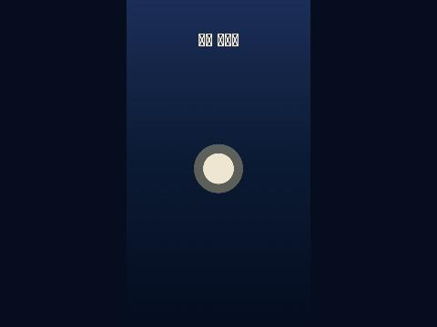
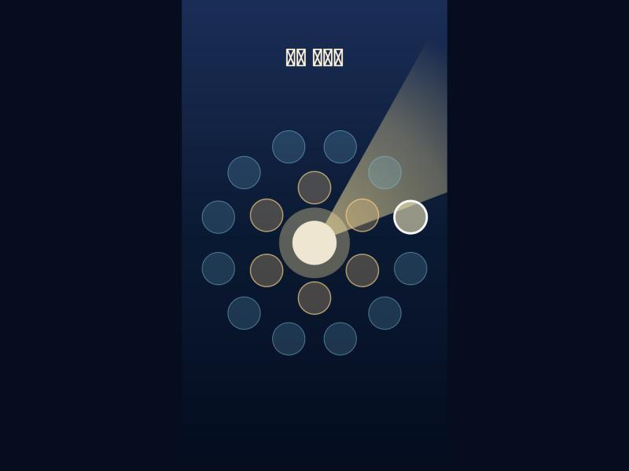
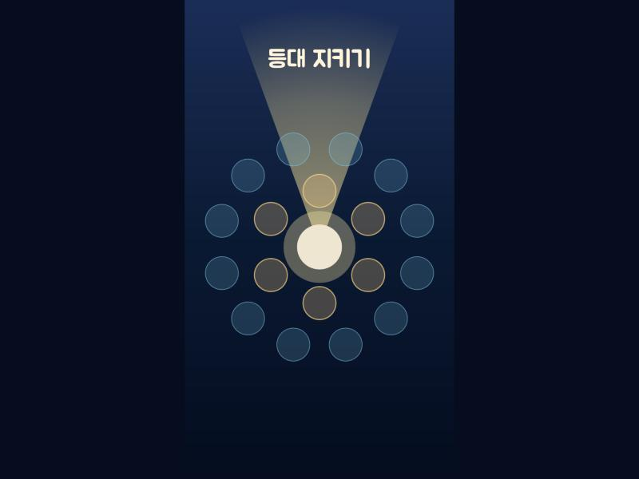
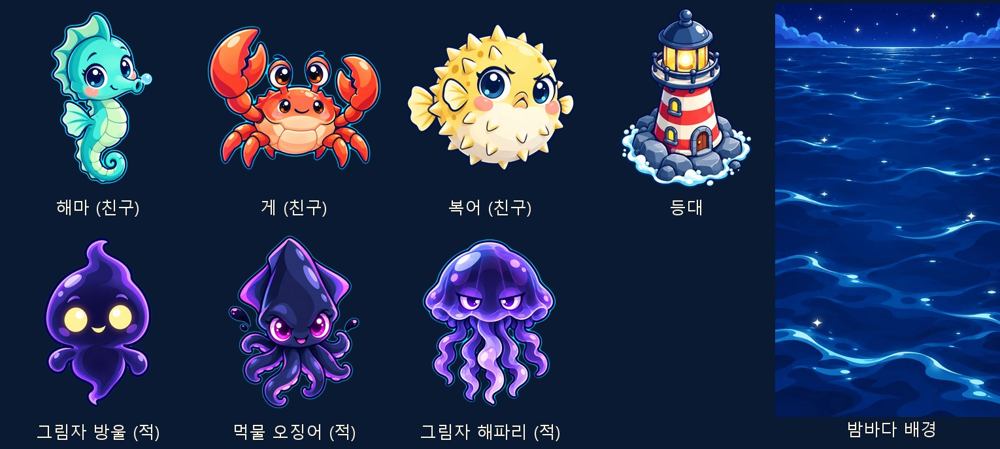
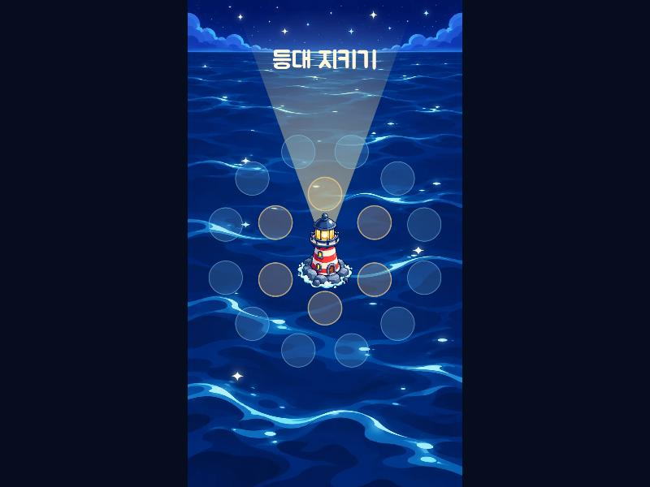
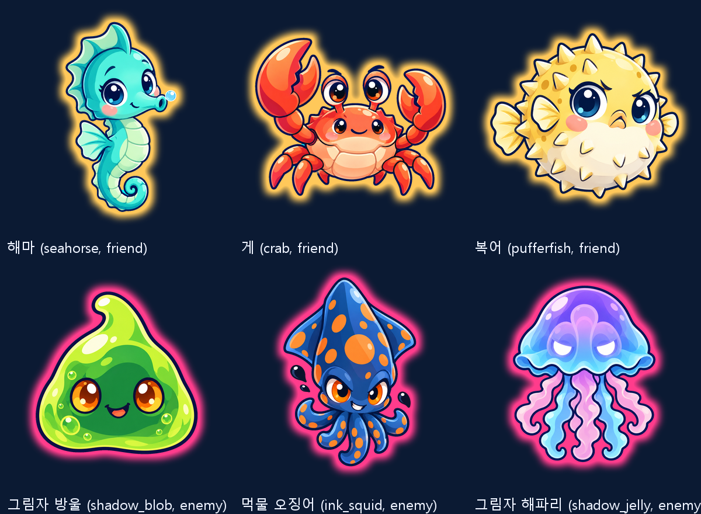
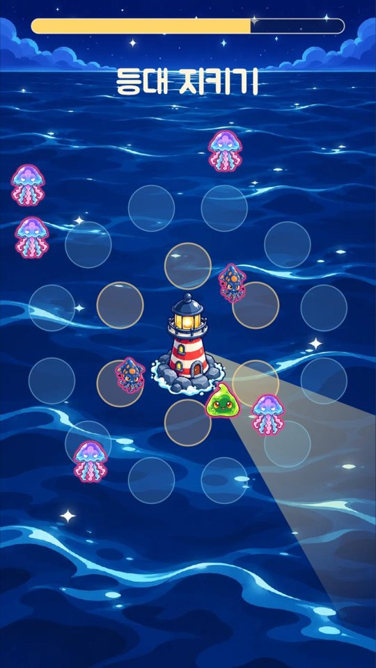
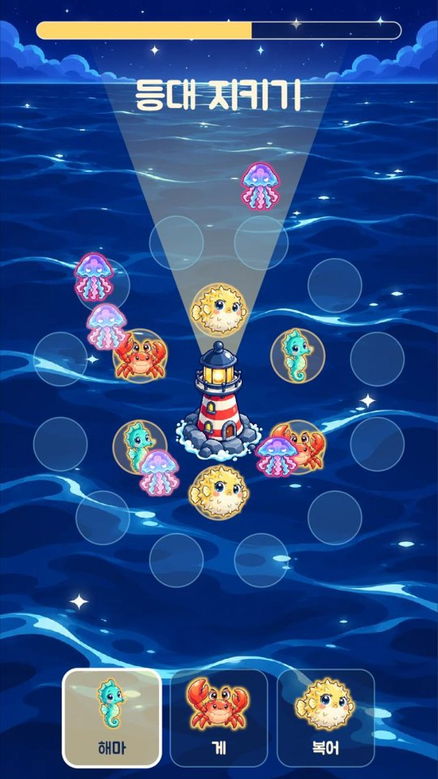
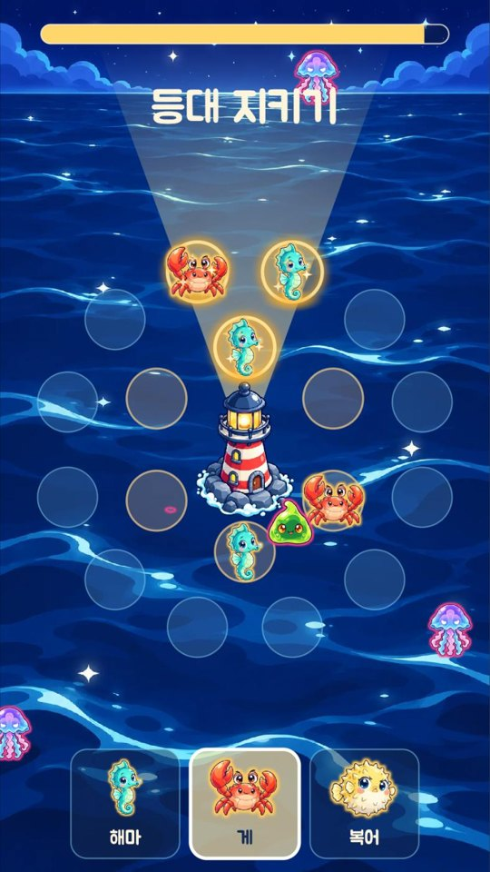
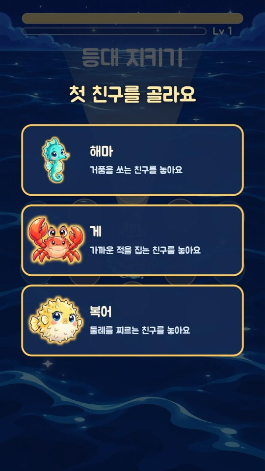

# 등대 지키기 작업 기록

## 0. 기획 (2026-10-20)

> 사용자: "이 게임은 여기까지 하고 다음엔 어떤 디펜스 게임을 만들면 좋을까? 지금과는 완전 다른 종류의 디펜스 게임이 좋겠는데"
> → 네 가지 중 "A로 하고 밤바다 등대를 지키는 바다 생물들 로 해서 새 폴더를 만들고 새 프로젝트로 하자."

### 결과 요약
| 질문 | 고른 것 |
|---|---|
| 종류 | A. 사방 로그라이크 디펜스 (가운데를 360도로 지키고, 웨이브마다 카드 3장 중 하나) |
| 테마 | 밤바다 등대를 지키는 바다 생물들 |
| 폴더·이름 | `C:\lighthouse_defense` · 등대 지키기 (Lighthouse Keepers) |
| 화면 | 웹(PWA) 세로 먼저 |
| 그림 | 숲 지키기처럼 Codex 카툰 + 컷아웃 |
| 공개 | 새 공개 저장소 + Pages 자동 배포 |

계획서 [plan.md](plan.md): 숲 지키기와 확실히 다르게 **등대 빛을 손가락으로 끌어 돌리는 조작**을 핵심으로 (빛 속의 어둠 생물은 느려지고 약해짐), 고리 자리(안쪽 6 · 바깥 12)에 친구, 빛 조각(경험치)으로 카드, 진주로 판 밖 성장, 밤 셋.

### 진행 방식
숲 지키기 마무리 뒤 같은 대화에서 질문 넷으로 방향을 정하고 계획서를 썼다.

### 검증
사용자 확인 대기.

### 발생한 문제와 해결
없음.

## 1. 프로젝트·저장소·자동 배포 (2026-10-20)

### 결과 요약
- `flutter create` (웹·Windows), Flame 추가. 세로 720 × 1280 고정 해상도 판에 밤바다 그러데이션, 가운데 등대 자리(임시 원), 제목
- 웹: `<title>`·PWA 이름 "등대 지키기", 세로(`portrait`), 바다색 / Windows: 창 540 × 960, 제목 "등대 지키기"
- 숲 지키기에서 `make_todo_html.py`, `serve_web.py`, `dart_test.yaml`, Pages 배포 설정을 가져와 이름·경로(`/lighthouse-defense/`)를 바꿈

### 진행 방식
| 파일 | 내용 |
|---|---|
| `lib/game/config.dart` | 720 × 1280, 등대 자리 (360, 660), 바다색 |
| `lib/game/lighthouse_game.dart` | `LighthouseGame`(고정 해상도 카메라), 바다 바탕, 등대 자리, 제목 |
| `lib/main.dart` | 판 하나 |
| `windows/runner/main.cpp` | 세로 창, 한글 제목을 `\uXXXX`로 (소스는 ASCII여야 한다: /WX가 C4819를 오류로) |
| `.github/workflows/pages.yml` | main 푸시마다 테스트 → 웹 빌드(`--base-href /lighthouse-defense/`) → Pages |

### 검증
- `flutter analyze` 문제 없음, `flutter test` 1/1, `flutter build windows` 성공
- 공개 저장소 https://github.com/Notard/lighthouse-defense 생성·푸시, Pages(GitHub Actions 방식) 켬 → 첫 배포 build·deploy 성공, https://notard.github.io/lighthouse-defense/ 200, 제목 "등대 지키기"
- 실제 사이트 화면: 세로 판·밤바다·등대 자리 확인. **한글 제목이 네모로** 보임 (글꼴 없음, `--no-web-resources-cdn`이라 대체 글꼴도 안 받음) → 3단계 글꼴에서

### 발생한 문제와 해결
1. 창 제목을 한글 이스케이프로 넣으려 했는데 셸(heredoc)과 편집 도구가 `\uB4F1`을 실제 한글로 풀어 넣었다 (C++ 소스에 한글 → 빌드 실패) → 파이썬 스크립트 파일에서 바이트로 바꿔 넣음. 처음에는 주석이 조건문 괄호 안에 들어가기도 했다

## 1-1. 여러 에이전트 + 루프 엔지니어링 구조 (2026-10-20)

> 사용자 (역할 표와 함께): "본격적인 개발은 이렇게 나눠서 하고 루프 엔지니어링 개념을 네가 조사해와서 여러 에이전트가 일하고 루프 엔지니어링으로 하는 구조로 가자."

### 결과 요약
- 조사: 루프 엔지니어링 = 에이전트가 계획 → 변경 → 관찰 → 고침을 반복하도록 **반복 구조(상태, 검증 관문, 끝내는 조건, 역할 분리, 상한, 사람 개입 지점)를 설계**하는 일. 정리는 [docs/loop.md](docs/loop.md)
- 사용자 표를 Flutter 프로젝트에 맞게 옮김: implementer(`lib/`·`tools/`) · tester(`test/`만) · balancer(`tools/balance/`·`balance/`, 표 숫자는 제안만) · reviewer(읽기만, 기본 거절) · 리드(문서·표·판단·커밋)
- 한 바퀴: 리드 표 → tester(빨간 불) → implementer(최대 3번) → 관문 → (balancer) → reviewer → 리드 판단·커밋. 카드 하나 최대 3바퀴, 넘으면 사용자에게

### 진행 방식
| 파일 | 내용 |
|---|---|
| `docs/loop.md` | 조사 요약(출처), 역할 표, 사람이 쓰는 것, 한 바퀴 그림, 상한·정지·자율성, 숲 지키기 교훈 → 관문 |
| `.claude/agents/{implementer,tester,balancer,reviewer}.md` | 역할별 지시·범위·순서·보고 형식, 모델(Opus·Sonnet), reviewer는 Read·Grep·Glob만 |
| `loop/roles.json` + `tools/loop/gate.py` | 역할별 고칠 수 있는 곳(allow)·금지(deny)·한 번에 30개 상한. git 변경 목록과 대조 |
| `tools/loop/check.sh` | 관문 1 분석·테스트, 2 범위, 3 웹 빌드 |
| `loop/STATE.md`, `loop/run-log.md`, `loop/tasks/_template.md` | 상태(정지 스위치 포함), 덧붙이기만 하는 기록, 작업 카드 틀 |
| `docs/design.md`, `docs/tests/README.md`, `data/tables/README.md`, `CLAUDE.md` | 설계 정답 뼈대, 테스트 표 쓰는 법, 숫자 표 소유, 프로젝트 규칙 |

### 검증
- `gate.py` 지금 변경(리드 문서 15개): lead 통과, implementer·tester·reviewer 거절
- 가짜 변경 10가지(역할마다 범위 안·밖): 모두 기대대로 통과/거절

### 발생한 문제와 해결
1. 조사 자료 중 wikidocs 글은 403으로 읽지 못함 → 나머지 넷으로 정리. "backpressure"·`PROGRESS.md` 같은 말은 읽은 자료에 없어 쓰지 않음

## 2. 등대 둘레 자리와 입력: 루프 첫 카드 002 (2026-10-20)

> 사용자: "응 고고" (루프 구조 확인 → 첫 바퀴 시작)

### 결과 요약
- 등대 둘레에 자리 18개 (안쪽 6 · 150, 바깥 12 · 270, 15° 엇갈림). 누르면 고르고(흰 테두리), 다시 누르거나 바다를 누르면 풀림
- 판 안 어디서든 끌면 등대 빛(폭 40°, 길이 640 부채꼴)이 손가락 쪽을 가리키고 끄는 동안 따라옴. 가운데 40 미만에서는 그대로
- 누르기/끌기 경계: **화면(논리) px 12** (1차 리뷰 뒤 바꿈)
- **루프가 실제로 돌았다**: tester(빨간 불) → implementer(첫 시도 통과) → 관문에서 테스트 파일 분석 경고 → implementer는 범위 밖이라 **보고만**, tester가 정리 → reviewer **거절**(6가지) → 리드가 설계·표 고침 → 2바퀴 → reviewer **승인**

### 진행 방식
| 바퀴 | 누가 | 무엇 |
|---|---|---|
| 준비 | 리드 | `docs/design.md` §2 (각도 0° 오른쪽·90° 아래, 자리 표, 입력 규칙, **코드 이름 표**로 tester·implementer 이름 맞춤), `docs/tests/02-ring.md` T2-01~22, `docs/acceptance/02-ring.md`, 카드 `loop/tasks/002-ring-input.md`, 브랜치 `loop/002-ring` |
| 1 | tester (Sonnet) | `test/ring_test.dart` 22개 + `test/support.dart`(게임 → 화면 좌표, 손가락 도우미). 구현 전이라 컴파일 안 됨 |
| 1 | implementer (Opus) | `lib/game/slots.dart`, `beam.dart`, `geometry.dart`, `board_input.dart`(판 전체를 덮는 입력 층 하나에서 누르기·끌기 판정), `config.dart`, `lighthouse_game.dart`. 첫 시도 23/23 |
| 1 | 관문 | 분석 실패: `test/support.dart` 불필요한 import 2개. implementer는 고치지 않고 "테스트 의문"으로 보고 → 리드가 tester에게 되돌림 → 정리 → 모두 통과 |
| 1 | reviewer (Opus, 읽기만) | **거절**: ① T2-21 허용 오차가 표보다 느슨 ② T2-19가 빈 곳 규칙을 검증 못 함(빼도 통과) ③ 12/13 px 경계 없음 ④ 12가 게임 좌표라 폰에서 약 6.5 px로 너무 민감 ⑤ 미만/이하 문구 ⑥ 여백에서 시작한 끌기 |
| 2 | 리드 | ④ 화면 px 기준으로 설계 변경, ⑤ 40 미만·48 이하, ⑥ 판 안에서 시작한 끌기만. 표: T2-19 보강, T2-21 화면 8 px·±0.01°, T2-23(화면 13 px → 끌기) |
| 2 | tester → implementer | T2-21 빨간 불 → 문턱을 캔버스 거리로 (첫 시도) |
| 2 | reviewer | **승인**: 1~6 해결, 새 문제 없음 |

### 검증
- 관문(`bash tools/loop/check.sh implementer`): 분석 문제 없음, 테스트 24/24, 범위 통과, 웹 빌드 통과 (리드가 직접 다시 돌림)
- 화면(리드, PC 마우스): 자리 18개 두 고리 색, O2 클릭 강조, 끌기로 빛이 끝점 쪽(약 320°), 끌기가 고르기를 바꾸지 않음
- 남음: 폰 세로 터치 (사용자)

### 발생한 문제와 해결
1. 미리보기 도구가 새 폴더의 `.claude/launch.json`이 아니라 이전 프로젝트 설정을 읽어 숲 지키기 서버를 띄움 → 멈추고 서버를 직접 띄움. 그때 Git Bash가 `--base /lighthouse-defense/`를 Windows 경로로 바꿔 404 → `MSYS_NO_PATHCONV=1` (숲 지키기에서도 겪은 것)
2. 폰 크기 흉내에서 화면 찍기가 이상하게 나옴 (숲 지키기 때와 같은 미리보기 문제) → PC 크기로 확인, 폰은 사용자에게
3. `gate.py` 출력이 Windows 콘솔에서 깨짐 → UTF-8로 출력

## 3. 카드 003: 글꼴·문구·그림 도구 (2026-10-20)

> 사용자: "계속" / 글꼴: "주아 Jua (추천)"

### 결과 요약
- **주아(Jua)** 글꼴 (Google Fonts, OFL 1.1): 원본 2,070 KB에서 쓰는 글자만 남겨 **42 KB** (111자). 웹 제목 "등대 지키기"가 네모 대신 주아로 보인다
- 문구 틀 `Strings` (한국어·영어 두 벌, `Lang`), 화면 글은 여기서만
- 숲 지키기 그림 도구 8개(`gen_art`, `cut_parts`, `blender_cutout`, `pack_sheets`, `build_sprites.sh`, `prep_props`, `make_art_preview`, `rig_helper`) + 공통 `art_common.py` + `lib/game/art.dart`를 세로·밤바다에 맞게 가져옴. 프롬프트는 리드 소유 `data/art/prompts.json`에서 읽기만
- 루프 **한 바퀴 만에 승인**

### 진행 방식
| 누가 | 무엇 |
|---|---|
| 리드 | 설계 §3, 테스트 표 T3-01~09, 인수 조건 A3-1~6, 카드, `data/art/prompts.json` 뼈대(밤바다 그림체), 주아 원본 받기 |
| tester | `test/font_test.dart`: 글꼴 파일·등록, 영문 숫자, 두 언어 문구, `lib/` 문자열 글자가 모두 글꼴에 (TrueType cmap 직접 읽기), 제목이 Strings·Jua, `strings.dart` 밖 문자열에 한글 없음 |
| implementer | `subset_font.py`(테스트와 같은 글자 고르기 규칙, cmap (3,1) 확인), 글꼴·라이선스, `strings.dart`, 제목, 도구 8개 + `art_common.py`(크로마 초록 배경 지우기 포함), `art.dart`. 범위 밖 `.gitignore`는 보고만 |
| 리드 | `.gitignore`(art 중간 산출물·logs), 웹에서 제목 확인 |
| reviewer | **승인**. 막지 않는 문제 6개를 카드 004로 (Codex 쓰기 범위, 시트 JSON 필수 키, 캐시, 빈 bbox, 미리보기 숫자, frame_size 뜻) |

### 검증
- 관문: 분석 문제 없음, 테스트 33/33, 범위 통과(18개), 웹 빌드 통과
- 도구 `--help` 종료 코드 0, 필수 인자 없으면 사용법 + 2 (implementer 확인, reviewer 코드로 확인)

### 발생한 문제와 해결
1. 주아는 굵기가 하나라 `fontWeight: w700`이면 가짜 굵게 그려짐 → 굵기를 뺌
2. reviewer: Codex를 `workspace-write`로 부르면 저장소 어디든 쓸 수 있음 → 카드 004에서 실행 뒤 `git status` 확인을 끝내는 조건에 넣기로

## 3. 카드 004: 그림 (2026-10-20)

> 사용자: (그림 모음을 보고) "좋아 다음으로."

### 결과 요약
- Codex로 그림 8개: 친구 **해마·게·복어**, 적 **그림자 방울·먹물 오징어·그림자 해파리**, **등대**(바위섬), **밤바다** 배경. 캐릭터는 모두 앞을 본다 (적이 사방에서 오므로). 해마를 먼저 그려 그림체 기준으로
- 게임: 밤바다 그림 위 가운데에 등대 (한 변 200), 자리·빛·제목이 위에 겹침
- Codex 안전 관문: Codex 실행 전후 git 상태를 비교해 `art/` 밖이 바뀌면 멈춤. 8번 모두 통과
- 사용자 승인 (배경이 위에서 본 바다가 아니라 수평선 풍경인 점을 알리고 그대로)

### 진행 방식
| 누가 | 무엇 |
|---|---|
| 리드 | `data/art/prompts.json`: 그림체(굵은 남색 외곽선, 밤바다에서 잘 보이는 빛나는 색), 크로마 초록 배경 지시는 캐릭터·소품에만(배경 그림과 부딪히지 않게, 카드 003 리뷰), 캐릭터 6·소품 2. 설계 §3-2, T3-10~16, 인수 조건, 카드 |
| tester | `test/art_test.dart` 7개, `waitUntil`. 표에 없던 `sprite` 이름을 표 의문으로 → 리드가 설계에 정함 |
| implementer | ① 도구 고침과 **안전 관문을 먼저**, ② Codex 그림 한 장씩 (사용량 제한 429로 먹물 오징어·배경이 두 번씩 재시도), ③ 크로마 초록 빼기 다지기(테두리 청록 줄 없애기), ④ `prep_props`(크기 한도 넘으면 품질 낮춰 다시), ⑤ 게임 표시·`SheetAction`·실패한 읽기 캐시 안 함 |
| 관문 | 테스트 파일의 쓰지 않는 import → implementer 보고만 → tester 정리 |
| 사용자 | 그림 모음·게임 화면 보고 승인 |
| reviewer | 승인. 안전 관문 사각지대(Codex가 커밋·stash하면 못 잡음, `art/` 안 다른 그림 덮어쓰기) 등 → 카드 005 |

### 검증
- 관문: 분석 문제 없음, 테스트 40/40, 범위 통과(24개), 웹 빌드 통과
- 리드: 작업 트리 깨끗, 브랜치 변경이 모두 예상 폴더 안, `git ls-files art/ref` 8개 (원본 18 MB, 확인용 `_check`는 무시)
- 그림 파일: `night_sea.webp` 83 KB, `lighthouse.webp` 31 KB

### 발생한 문제와 해결
1. Codex 사용량 제한(429)으로 두 장이 실패 → 같은 그림 최대 2번 다시 (배경은 5분 기다린 뒤)
2. 실제 그림에서 크로마 초록이 테두리에 남음 → 배경과 이어진 초록·둘러싸인 초록 틈·빛이 비친 초록 띠를 나눠 지움, 번짐은 G를 (R+B)/2로
3. 배경 원본이 941 × 1672로 작게 나옴 → 1080 × 1920으로 키워 씀 (사용자 승인, 설계에 적음)
4. 리드 실수: 설계를 고친 뒤 tester 범위 관문을 돌려 리드 변경이 함께 잡힘 → 관문을 먼저 돌리고 고치기

## 3. 카드 005: 캐릭터 컷아웃과 편 오라 (2026-10-20)

> 사용자: "그런데 적의 오징어와 문어가 비슷하게 생겨서 게임에선 구분이 잘 안 갈 것 같다. 적은 테두리에 오라가 다르게 가는 편이 좋을지도 모르겠네." → (시안) "응 적과 아군은 오라로 구분하고, 적도 컬러풀하게 넣어서 만들자." → "응 4단계"

### 결과 요약
- 여섯 캐릭터 컷아웃 애니메이션 시트 (친구: 기본·공격·맞음·쓰러짐 / 적: 이동·공격·맞음·쓰러짐), 프레임 256, 합계 **1.85 MB**, 캐릭터마다 GIF
- **편 오라**: 친구 금빛, 적 분홍빛을 시트에 구워 넣음 (청록 테두리 빛은 걷음). 값은 `data/art/aura.json`
- 적 셋을 **알록달록하게 다시**: 연두 방울, 남청에 주황 점 오징어(화살촉 머리·지느러미로 문어와 다르게), 보라→하늘 해파리
- 캐릭터 키는 첫 숫자 표 `data/tables/characters.csv`

### 진행 방식
| 바퀴 | 누가 | 무엇 |
|---|---|---|
| 1 | 리드 | characters.csv, 설계 §3-3 (동작 표·키·도구 다지기), T3-17~24, 카드. 큰 카드용 `gate.py --max-files` |
| 1 | tester → implementer | 시트 테스트 → 안전 관문 사각지대 메움(HEAD·stash·art 안 다른 파일, 가짜 Codex로 5가지 시연), pack_sheets 형식 검사, 리그 6·시트·GIF |
| 1 | 사용자 | 오징어와 (나중 친구) 문어가 헷갈릴 것 → 편 오라 제안 → 리드 시안(`preview/05_aura_mock.jpg`) → 승인 + 적도 알록달록 |
| 2 | 리드 | aura.json, 적 프롬프트(색·오징어 모양·테두리 빛 없이), T3-25·26 |
| 2 | implementer | 적 셋 Codex 다시(안전 관문 통과), 적 리그 다시, 청록 빛 걷기(strip_rim)·오라 굽기(add_aura), 해마 꼬리 이음매·오징어 파란 띠 |
| 2 | 관문 | T3-26 실패: 테스트가 픽셀을 프리멀티플라이 값으로 읽음. implementer가 Python으로 같은 숫자를 재현해 근거 보고(오라를 진하게 하는 우회 안 함) → tester가 straight 값으로 (기준 그대로) |
| 2 | 사용자 · reviewer | 승인 (시트 합계는 리드가 재서 1,851,454 B) |

### 검증
- 관문: 분석 문제 없음, 테스트 50/50, 범위 통과(상한 70), 웹 빌드
- 오라 픽셀(첫 프레임 반투명, 편 색 ±60): 4,500~5,400개, 반대편 0개

### 발생한 문제와 해결
1. 그림체 기준(해마)의 "청록 빛" 설명이 다른 캐릭터에 옮겨 가 모두 같은 테두리 빛 → 편을 가르기 어려움 → 걷어내고 편 오라
2. 연두 방울이 크로마 초록 배경과 가까움 → 진한 외곽선 덕에 몸 안 반투명 0개 확인
3. 테스트 읽기 방식(프리멀티플라이) 문제 → 위 2바퀴

## 4. 카드 006: 사방에서 오는 적·등대 불빛·빛줄기 (2026-10-20)

> 사용자: "응 4단계" → (스크린숏 확인) "응"

### 결과 요약
- 첫 숫자 표 넷: `enemies.csv`(체력·속도·갉는 양·간격·몸 반지름), `beam.csv`(폭 40°·길이 640·느려짐 0.5·피해 1.5배), `lighthouse.csv`(불빛 100·나타나는 거리 780), `practice.csv`(2초마다, 최대 8). `tools/gen_tables.py`가 `lib/game/tables.g.dart`를 만듦 (`--check`)
- 적이 화면 밖 사방에서 나타나 등대로 곧장 오고, 닿으면 멈춰 불빛을 갉음. 빛 속 적은 느려지고 받는 피해가 커짐. 쓰러지면 0.8초 뒤 사라짐
- 위쪽 불빛 막대, 0이 되면 판이 멈추고 "불빛이 꺼졌어요"
- 앱은 연습 스폰을 켬 (7단계 웨이브 전까지 확인용)
- 카드 005 리뷰 도구 일: 오라 배율 frame_px/256, strip_rim 리그 옵션, CODEX_BIN 시험 전용 문구

### 진행 방식
| 누가 | 무엇 |
|---|---|
| 리드 | 표 넷, 설계 §4 (코드 이름 표), T4-01~15, A4-1~7, 카드 |
| tester | T4-01~15 (숫자는 CSV를 직접 읽음). 모호한 점 둘(꺼짐 문구 붙는 프레임, 막대 크기 뜻) → 리드가 설계에 적음 |
| implementer | 변환기 → 적·빛 속·불빛·꺼짐 → 연습 스폰 → 적 그림 → 글꼴 → 도구 일. 결정 요청 셋을 근거와 함께 보고 |
| 리드 | 적 리그도 strip_rim 켬(시트 그대로 나오게), 빛 경계 여유 1e-3, 웹에서 직접 확인·스크린숏 |
| reviewer | 승인 (꼭 고칠 것 없음, 미룰 것 다섯) |
| 사용자 | 승인 |

### 검증
- 관문: 분석 문제 없음, 테스트 65/65, 범위, 웹 빌드. `gen_tables.py --check` 같음
- 웹 연습 판: 적이 오고 갉음, 막대 줄어듦, 빛 끌기, 꺼짐 멈춤
- 시트 불변: 도구를 고친 뒤 여섯 캐릭터를 다시 만들어 바이트 비교

### 발생한 문제와 해결
1. 설계의 빛 경계 여유 1e-6: Flame `Vector2`가 32비트라 경계 점이 1.7e-6° 밀림 → 1e-3으로
2. 설계 이름 `beam.contains`·`Enemy.distance`가 Flame 이름과 겹침 → contains는 인자를 넓혀 원래 뜻 유지, Enemy는 Component로
3. strip_rim을 친구만 켜니 적 시트가 조금 바뀜 (예전 도구가 적도 조금 걷었음) → 여섯 모두 켜서 그대로
4. 테스트 환경에서 Flame 이미지 캐시의 처리 안 된 오류 → 그림을 직접 읽어 캐시에 넣는 `loadGameImage`
5. 웹 첫 실행에서 적이 늦게 보임: 첫 적은 2초 뒤 화면 밖 780에서 출발해 화면에 들어오기까지 시간이 걸림 (정상)

### 다음 카드로 넘긴 것 (reviewer)
탭을 숨겼다 돌아올 때 큰 dt, 닿는 거리 안 스폰 시 남은 시간, 그림 전 hit, cut_parts 도움말, gen_tables inf·nan, 갉기 타이머와 attack 이벤트 프레임

## 5. 카드 007: 친구 놓기와 자동 공격 (2026-10-20)

> 사용자: "응" (4단계 승인 뒤 5단계로) → (스크린숏) "응. 등대 빛은 아군을 조금 더 강하게 해주는 효과가 좋지 않을까?" → 카드 008

### 결과 요약
- 판 아래 **친구 쟁반**(해마·게·복어): 단추로 들고 빈 자리를 눌러 놓기 (연습용, 6단계 카드가 대신함)
- 자동 공격 (`data/tables/friends.csv`): 사거리 안에서 등대에 가장 가까운 적을 노림, 공격 시작 1/3초 뒤 효과(그림 이벤트 프레임에 맞춤)
  - 해마: 과녁을 따라가는 거품 / 게: 한 마리 집기(과녁이 먼저 쓰러지면 헛침) / 복어: 둘레 모두
- 한 번 update 최대 0.1초 (탭을 숨겼다 돌아와도 불빛이 한꺼번에 꺼지지 않음)
- 카드 006 리뷰 작은 일: 닿는 거리 안 스폰, 갉는 그림과 피해 맞춤, 그림 전 hit, 도구 도움말, 표 숫자 검사(inf·nan·빈 값·attack 값)

### 진행 방식
| 바퀴 | 누가 | 무엇 |
|---|---|---|
| 1 | 리드 | friends.csv, 설계 §5 (과녁 규칙·windup·거품·쟁반·코드 이름), T5-01~17, A5-1~6 |
| 1 | tester → implementer | 테스트 17 → 구현 82/82. 판단 셋(dt 0 프레임, 거품 맞음 판정 순서, 쟁반 양옆은 바다)을 리드가 설계에 |
| 1 | 리드 | 웹에서 여섯 마리 놓고 확인: 친구가 적을 쓰러뜨려 불빛이 버팀 |
| 1 | reviewer | **거절**: 친구가 dt 0 update에서도 공격 시작, T5-16이 느슨함(꺼진 뒤 멈춤을 확인 못 함) |
| 2 | 리드 → tester → implementer | T5-16 엄격히, T5-18(dt 0)·T5-19(꺼짐 멈춤), A5-7 → 한 줄 고침 + 그리기 숫자 config로 + attack 값 검사 → 84/84 |
| 2 | reviewer · 사용자 | 승인 |

### 검증
- 관문: 분석 문제 없음, 테스트 84/84, 범위, 웹 빌드, `gen_tables.py --check`
- 커밋별 범위: tester는 test/만, implementer는 lib/·tools/만 (`git show --stat`)

### 발생한 문제와 해결
1. 테스트 도우미의 `update(0)`이 "첫 update"로 쳐져 경계가 흔들림 → "dt ≤ 0이면 아무것도 안 함" 규칙 (적·친구·거품)
2. 그 규칙이 친구에 빠짐 → reviewer가 잡음 (2바퀴)
3. 쟁반 영역이 2단계 테스트의 바다 누르기 점과 겹침 → 단추를 가운데에 모음
4. 미룸: T5-11(거품이 다른 적을 맞히지 않음)을 다른 적을 두고 더 단단히

## 5. 카드 008: 빛 속 친구가 힘을 얻음 (2026-10-20)

> 사용자: "등대 빛은 아군을 조금 더 강하게 해주는 효과가 좋지 않을까?" → (스크린숏) "응"

### 결과 요약
- 빛 속 친구(자리 가운데가 빛 속)는 쉬는 시간이 `friend_haste`(1.5)배 빨리 줄어 더 자주 공격 (`beam.csv` 새 칸)
- 빛 속 친구는 자리 원에 금빛 고리가 숨쉬고, 후광·발밑 빛·떠오르는 반짝이
- 빛을 적 쪽(느리고 약하게)과 친구 쪽(빠르게) 중 어디로 돌릴지 고르는 재미
- 카드 007에서 미룬 T5-11 강화: 터진 거품이 바로 옆 다른 적을 맞히지 않음(T8-05)

### 진행 방식
| 누가 | 무엇 |
|---|---|
| 리드 | beam.csv friend_haste, 설계 §5-2, T8-01~05, A8 |
| tester | T8-01~05. 표의 시간 계산 실수 둘을 짚음 (방울이 두 번째에 죽음, 쉬는 시간이 끝나 다시 공격) → 리드가 표 고침 |
| implementer | 89/89 |
| 리드 | 웹 확인: 발밑 금빛이 빛줄기 노란빛에 묻힘 → implementer가 고리·후광·반짝이로 다듬음 → 다시 확인 |
| reviewer · 사용자 | 승인 |

### 발생한 문제와 해결
1. 테스트 표의 시간 계산 실수 → tester가 숫자로 따져 잡아냄 (표가 정답이어도 표가 틀릴 수 있음: tester의 "모호하면 보고" 규칙이 효과)
2. 같은 색 계열(빛줄기 노랑 위 금빛)이라 안 보임 → 진한 주황 금빛 + 흰 금빛 선으로 대비

## 6. 카드 009: 빛 조각과 레벨업 카드 (2026-10-20)

> 사용자: "응" → (직접 플레이) "근데 처음 해마를 고르고 나서 다음 카드가 나오기 전까지 적이 너무 많이 나오네" → (표 조정) "응 다음으로 가자"

### 결과 요약
- 쓰러진 적이 빛 조각(`xp`)을 떨어뜨리고, 조각은 잠깐 반짝인 뒤 등대로 빨려 듦. 조각 막대와 `Lv n`
- 레벨에 드는 조각 3, 6, 9, … (`progression.csv`). 오르면 카드 3장 창, 판이 멈춤
- 카드 10종 (`cards.csv`): 친구 셋·친구 강화 셋(피해 ×1.3, 두 번)·넓은 빛·먼 빛·밝은 등대·되살아나는 불빛. 무게에 따라 뽑고 같은 씨앗이면 같은 순서
- 카드 판(앱): 시작에 첫 친구 카드 셋 → 놓을 자리 누르기. 연습 판(테스트)에는 쟁반이 남음
- 사용자 의견으로 연습 스폰 2초·8마리 → 3.5초·4마리, 첫 레벨 조각 5 → 3

### 진행 방식
| 누가 | 무엇 |
|---|---|
| 리드 | 표 셋(enemies xp, progression, cards), 설계 §6 (두 가지 판, 카드 규칙, 멈춤, 코드 이름), T6-01~20 |
| tester | 테스트 20. "카드가 2장뿐인 판"이 표대로는 만들 수 없음을 짚음 → 표 고침 |
| implementer | 구현. tray가 nullable이 되어 friends_test가 컴파일되지 않자 범위 밖이라 고치지 않고 보고 (우회 없음). 카드 표의 °가 글꼴에 없음도 보고 |
| 리드 · tester | ° → 도, 표·글꼴 다시 / friends_test `tray!` → 108/108 |
| reviewer | 승인 (미룸: 멈춤 테스트 보강, progression 양수 검사, T6-19가 우연에 기댐, 그리기 숫자) |
| 사용자 | 직접 플레이: 적이 너무 많음 → 리드 표 조정 → T6-19가 정말 깨짐(리뷰가 미리 짚은 것) → tester 고침 |

### 발생한 문제와 해결
1. 미리보기 창이 초당 1~2프레임으로 느려져 프레임 상한(0.1초) 때문에 게임 시간이 느리게 흐름 → 게임 문제 아님 (STATE에 적음)
2. 표 숫자를 바꾸자 우연에 기대던 테스트가 깨짐 → 친구를 해파리 사거리 밖(O1)에 두게 표를 고침. reviewer의 "미룸" 경고가 바로 들어맞음

